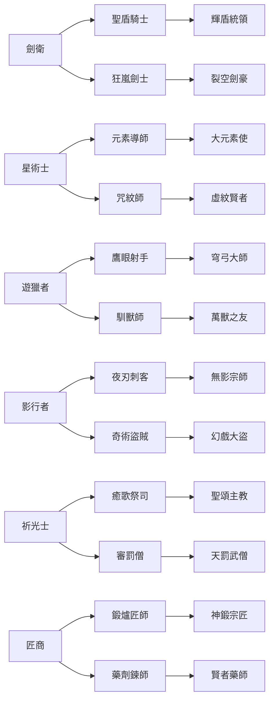
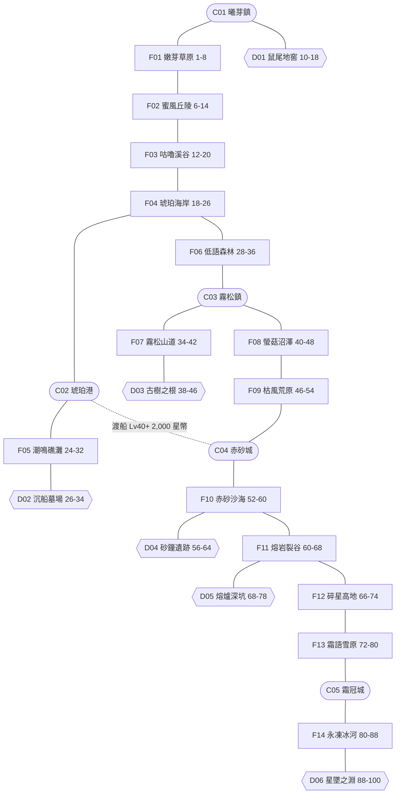
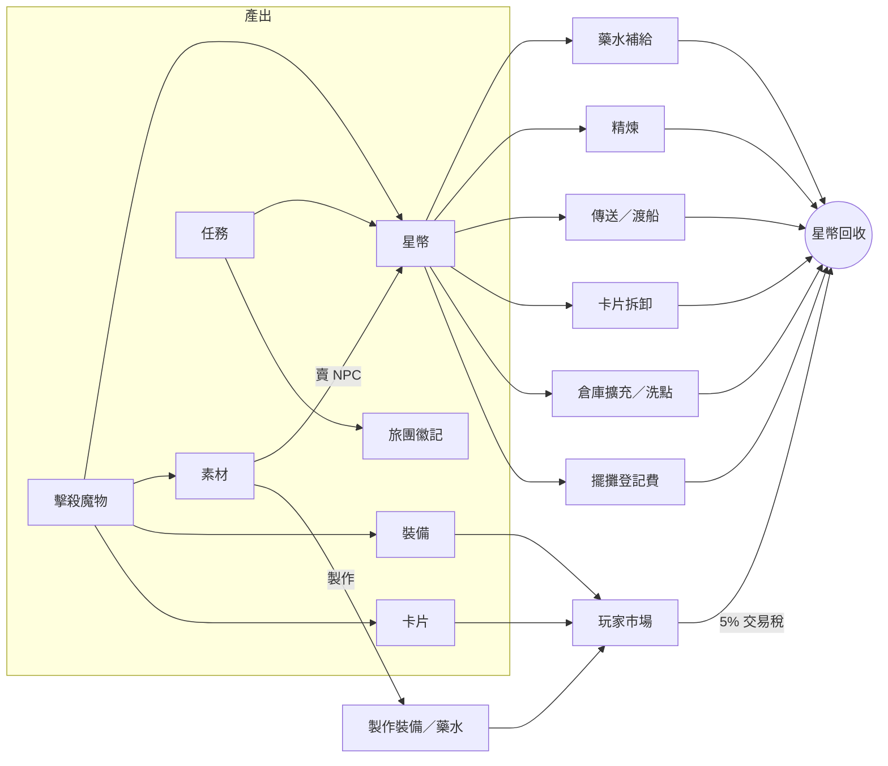

# 《星憶旅團》遊戲設計文件（GDD）v0.1

> 2D 網頁多人線上 RPG｜Phaser 3 + Colyseus｜伺服器權威
> 本文件所有名稱、世界觀、魔物、地圖與數值皆為原創設定。
> 本文件是後續各開發階段的「資料來源」：職業、魔物、道具、地圖最終都會轉成 JSON/DB 資料表，程式只讀資料、不寫死內容。

## 目錄

1. [設計取捨與決議](#1-設計取捨與決議)
2. [世界觀](#2-世界觀)
3. [職業與轉職樹](#3-職業與轉職樹)
4. [能力值系統（六項素質）](#4-能力值系統六項素質)
5. [傷害公式](#5-傷害公式)
6. [世界地圖：5 座城市與 20 張野外／地下城](#6-世界地圖5-座城市與-20-張野外地下城)
7. [魔物表（60 種）](#7-魔物表60-種)
8. [裝備系統](#8-裝備系統)
9. [卡片系統](#9-卡片系統)
10. [經濟循環](#10-經濟循環)
11. [資料表對應（給後續階段）](#11-資料表對應給後續階段)

---

## 1. 設計取捨與決議

下列項目有多種做法，先列選項與本文件採用的建議。若要改，只需調整對應章節的參數，不影響其他章節。

| # | 議題 | 選項 | 本文件採用 | 理由 |
|---|---|---|---|---|
| 1 | 等級上限 | A. 60（內容少、好平衡）／B. 100／C. 無上限 | **B. 100** | 20 張地圖每張約 8 級寬度，剛好鋪滿 1–100 |
| 2 | 轉職結構 | A. 一轉即終點／B. 初始→二轉分支→三轉進階 | **B**：Lv30 二選一、Lv70 進階 | 6 初始職業 → 12 分支，Build 多樣且技能表可分批上線 |
| 3 | 素質配點 | A. 自動成長／B. 自由配點（成本遞增） | **B** | 掛機打怪型遊戲的長期樂趣來自 Build |
| 4 | 精煉失敗懲罰 | A. 裝備消失／B. 降級／C. 無懲罰僅耗材 | **B. 降 1 級**（+7 以上），可用保護道具 | 保留刺激感與星幣回收，又不會讓玩家一次歸零退坑 |
| 5 | 卡片掉率 | A. 0.01%（極稀有）／B. 0.05%／C. 0.5% | **B**：一般 0.05%、菁英 0.5%、首領 2% | 網頁遊戲在線人數較少，過低掉率會讓市場無貨 |
| 6 | 死亡懲罰 | A. 無／B. 損失當前等級 1% 經驗／C. 掉落道具 | **B**（Lv10 以下免罰） | 有壓力但不勸退 |
| 7 | PvP | A. 首版不做／B. 專用競技地圖／C. 全圖 PK | **A**（保留傷害公式的 PvP 係數欄位） | 先把 PvE 與經濟做穩 |
| 8 | 交易方式 | A. 僅面對面／B. 擺攤／C. 全服拍賣行 | 首版 **A + B**，拍賣行列為後續 | 擺攤讓城市有人氣，實作量也較小 |

---

## 2. 世界觀

### 2.1 背景

世界名為 **埃索蘭（Aesoran）**。遠古時代，天空中懸著一顆名為「**星核**」的巨大光球，它記錄著世上所有生命的記憶。千年前的「**墜星之夜**」，星核不明原因碎裂，碎片如雨落遍大陸，稱為「**星屑**」。

- 星屑滲入土地與生物，使野生動植物變異為 **魔物**。
- 魔物被擊倒時，體內星屑偶爾會凝結牠一生的記憶，化為一張 **星憶卡**（即卡片系統的由來）。
- 將星憶卡嵌入裝備，就能借用該魔物的一部分力量。

### 2.2 玩家身分

玩家是「**拾星者**」——隸屬各城市「拾星旅團」公會的冒險者。旅團的使命是回收星屑、蒐集星憶卡，拼湊出墜星之夜的真相。

### 2.3 主線脈絡（對應地圖推進）

| 章節 | 等級 | 地區 | 劇情重點 |
|---|---|---|---|
| 序章 | 1–20 | 曦芽鎮周邊 | 加入旅團，學會戰鬥，發現地窖鼠群被星屑異化 |
| 第一章 | 18–34 | 琥珀港、礁灘、沉船 | 追查沉船上的星屑走私，首次遇到「蝕」的力量 |
| 第二章 | 28–48 | 霧松鎮、古樹、沼澤 | 古樹之根被蝕化，森林守護者失控 |
| 第三章 | 46–68 | 赤砂城、遺跡、裂谷 | 時砂祭司試圖用星屑逆轉時間 |
| 第四章 | 66–88 | 高地、霜冠城、冰河 | 發現星核最大的碎片墜落在極北 |
| 終章 | 88–100 | 星墜之淵 | 面對吞食星核的墜星之龍 |

### 2.4 美術基調

- Q 版 2–2.5 頭身角色，斜 45° 視角地圖（Tiled isometric 或 staggered）。
- 色彩明亮、輪廓圓潤；魔物以「可愛但有辨識度」為原則，首領才走威嚴路線。
- 每座城市一個主色：曦芽鎮（嫩綠）、琥珀港（橙金）、霧松鎮（霧藍綠）、赤砂城（磚紅）、霜冠城（冰藍白）。

---

## 3. 職業與轉職樹

### 3.1 規則

- 創角時從 6 個 **初始職業** 擇一。
- **Lv30** 至所屬城市公會完成二轉任務，從 2 個分支擇一。
- **Lv70** 完成三轉任務，進階為該分支的上位職業（不再分支）。
- 每升 1 級獲得 1 點技能點；轉職時不重置已學技能。
- 轉職後可用「洗點卷」重置素質與技能（星幣回收點，見經濟章節）。

### 3.2 轉職樹



### 3.3 初始職業

| 職業 | 定位 | 可用武器 | 主素質 | HP 係數 | SP 係數 | 代表技能（初始） |
|---|---|---|---|---|---|---|
| 劍衛 | 近戰坦克／物理輸出 | 單手劍、雙手劍、長槍、盾 | 力量、體魄 | 30 | 4 | 重斬（單體 180%）、挑釁（強制仇恨）、鐵壁（減傷 20%） |
| 星術士 | 遠程魔法輸出 | 法杖、魔導書 | 靈智、專注 | 14 | 12 | 星火彈（焰 160%）、潮湧（潮 範圍 120%）、冥想（SP 回復） |
| 遊獵者 | 遠程物理輸出 | 弓、弩 | 專注、迅捷 | 20 | 6 | 二連射（2×100%）、箭雨（範圍 110%）、鷹眼（命中 +20） |
| 影行者 | 高迴避／暴擊刺客 | 匕首、爪、短劍 | 迅捷、機運 | 22 | 6 | 背刺（背後 220%）、潛行、淬毒（附加中毒） |
| 祈光士 | 治療／輔助 | 權杖、鎚、盾 | 靈智、體魄 | 18 | 10 | 癒光（治療）、祝福（全素質 +）、輝矢（輝 140%） |
| 匠商 | 經濟／製造／負重 | 斧、鎚、推車 | 力量、專注 | 26 | 5 | 推車衝撞（150%）、議價（NPC 折扣）、開設攤位 |

> HP/SP 係數用於第 4 章的 MaxHP、MaxSP 公式。

### 3.4 二轉（Lv30）與三轉（Lv70）

| 初始 | 二轉 | 三轉 | 定位與特色 |
|---|---|---|---|
| 劍衛 | 聖盾騎士 | 輝盾統領 | 盾牌精通、團隊減傷光環、輝屬性反擊；主坦 |
| 劍衛 | 狂嵐劍士 | 裂空劍豪 | 雙手武器、連段與吸血、低血量增傷；近戰爆發 |
| 星術士 | 元素導師 | 大元素使 | 焰／潮／嵐／岩四系大範圍魔法；清怪之王 |
| 星術士 | 咒紋師 | 虛紋賢者 | 地面符紋陷阱、減益與控場、SP 灼燒；控場 |
| 遊獵者 | 鷹眼射手 | 穹弓大師 | 超遠射程、蓄力狙擊、破甲箭；單體輸出 |
| 遊獵者 | 馴獸師 | 萬獸之友 | 可捕捉並召喚一隻魔物作戰（寵物系統入口） |
| 影行者 | 夜刃刺客 | 無影宗師 | 雙持、暴擊倍率提升、隱身突襲；單體爆發 |
| 影行者 | 奇術盜賊 | 幻戲大盜 | 偷竊（額外掉落判定）、分身、煙幕；打寶型 |
| 祈光士 | 癒歌祭司 | 聖頌主教 | 群體治療、復活、淨化；隊伍核心補師 |
| 祈光士 | 審罰僧 | 天罰武僧 | 拳套近戰、輝屬性連擊、對亡骸／魔裔特攻 |
| 匠商 | 鍛爐匠師 | 神鍛宗匠 | 製作武器防具、精煉成功率加成、屬性附魔 |
| 匠商 | 藥劑鍊師 | 賢者藥師 | 調製藥水、投擲爆劑（範圍傷害）、召喚藥草傀儡 |

---

## 4. 能力值系統（六項素質）

### 4.1 六項素質

| 素質 | 代號 | 主要影響 |
|---|---|---|
| 力量 | `pow` | 近戰物攻、負重上限 |
| 迅捷 | `swf` | 迴避、攻擊速度 |
| 體魄 | `con` | MaxHP、固定物理減傷、HP 自然回復、異常狀態抗性 |
| 靈智 | `mnd` | 魔攻、MaxSP、固定魔法減傷、SP 自然回復 |
| 專注 | `foc` | 命中、遠程物攻、傷害穩定度、詠唱時間縮短 |
| 機運 | `for` | 暴擊率、暴擊抵抗、掉落率微幅加成 |

### 4.2 配點規則

- 創角時六項素質皆為 **5**，另有 **10 點** 自由分配。
- 每升 1 級獲得 **6 點** 素質點（Lv100 累計 594 點）。
- 單項素質上限 **100**（不含裝備加成）。
- 將素質從 `v` 提升到 `v+1` 的花費：`cost(v) = 1 + floor(v / 10)`。

| 素質區間 | 每點花費 | 累計花費（從 5 起算至區間終點） |
|---|---|---|
| 5 → 10 | 1 | 5 |
| 10 → 20 | 2 | 25 |
| 20 → 30 | 3 | 55 |
| 30 → 40 | 4 | 95 |
| 40 → 50 | 5 | 145 |
| 50 → 60 | 6 | 205 |
| 60 → 70 | 7 | 275 |
| 70 → 80 | 8 | 355 |
| 80 → 90 | 9 | 445 |
| 90 → 100 | 10 | 545 |

> 設計意圖：滿等總點數 604（含創角 10 點），可以「一項 100 + 少量雜點」或「兩項 70 + 一項 30」，逼玩家做取捨。

### 4.3 衍生能力值

`Lv` 為角色等級，`equip.*` 為裝備與卡片加總，`floor` 為無條件捨去。

| 能力 | 公式 |
|---|---|
| MaxHP | `floor((100 + Lv × 職業HP係數) × (1 + con × 0.01)) + equip.hp` |
| MaxSP | `floor((30 + Lv × 職業SP係數) × (1 + mnd × 0.01)) + equip.sp` |
| 近戰物攻 ATK | `weaponAtk + pow × 2 + floor(pow / 10)² + floor(foc / 2) + floor(Lv / 2) + equip.atk` |
| 遠程物攻 ATK | `weaponAtk + foc × 2 + floor(foc / 10)² + floor(pow / 2) + floor(Lv / 2) + equip.atk` |
| 魔攻 MATK | `weaponMatk + mnd × 2 + floor(mnd / 8)² + floor(Lv / 2) + equip.matk` |
| 物防 DEF | `equip.def`（百分比減傷用，見第 5 章） |
| 魔防 MDEF | `equip.mdef` |
| 固定物理減傷 | `floor(con / 2) + floor(Lv / 4)` |
| 固定魔法減傷 | `floor(mnd / 2) + floor(Lv / 4)` |
| 命中 HIT | `Lv + foc × 2 + equip.hit` |
| 迴避 EVA | `Lv + swf × 2 + equip.eva` |
| 暴擊率 CRIT% | `1 + for × 0.3 + equip.crit`（上限 60%） |
| 暴擊抵抗 | `for × 0.1`（直接扣減攻擊方暴擊率） |
| 攻擊間隔（毫秒） | `weaponInterval × (1 − min(0.6, swf × 0.004 + foc × 0.001 + equip.aspd))` |
| 詠唱時間 | `baseCast × (1 − min(0.7, foc × 0.005 + mnd × 0.002))` |
| HP 自然回復（每 6 秒） | `floor(MaxHP × 0.005) + floor(con / 5)` |
| SP 自然回復（每 6 秒） | `floor(MaxSP × 0.01) + floor(mnd / 6)` |
| 負重上限 | `2000 + pow × 30` |
| 掉落率加成 | `+ for × 0.05%`（相對加成，上限 +5%） |

武器基礎攻擊間隔：匕首 600、爪 650、單手劍 750、弓 800、權杖／鎚 850、法杖 900、長槍 950、斧 1000、雙手劍 1050（毫秒）。

### 4.4 經驗值曲線

- 升到下一級所需經驗：`expNext(Lv) = floor(40 × Lv^2.4 + 60 × Lv)`
- 魔物經驗見第 7 章（一般魔物約為「同等級基準 HP × 0.25」）。
- 等級差修正（玩家等級 − 魔物等級 = `d`）：

| d | 經驗倍率 |
|---|---|
| d ≤ −10（越級太多） | 60% |
| −9 ~ −5 | 110% |
| −4 ~ +4 | 100% |
| +5 ~ +9 | 70% |
| +10 ~ +14 | 40% |
| d ≥ +15 | 10% |

| 參考等級 | 升級所需經驗 | 同級一般魔物經驗 | 約需擊殺數 |
|---|---|---|---|
| 1 | 100 | 10 | 10 |
| 10 | 10,647 | 52 | 約 200 |
| 30 | 142,130 | 262 | 約 540 |
| 50 | 481,176 | 632 | 約 760 |
| 70 | 1,076,448 | 1,162 | 約 930 |
| 90 | 1,965,336 | 1,852 | 約 1,060 |

> 組隊（2–6 人）每多 1 人總經驗 +10% 後均分，鼓勵組隊。任務與首領經驗另計。

---

## 5. 傷害公式

所有計算都在伺服器執行，客戶端只收結果（傷害數字、是否暴擊、是否迴避）。

### 5.1 計算流程

```
1. 命中判定（物理普攻與物理技能；魔法必中）
     hitRate = clamp(85 + (攻擊方HIT − 防守方EVA) × 0.5, 5, 95) %
     ※ 暴擊必定命中，先判暴擊再判命中

2. 暴擊判定（僅物理；魔法技能預設不暴擊，除非技能資料標記可暴擊）
     critRate = clamp(攻擊方CRIT% − 防守方暴擊抵抗, 0, 60) %
     critMul  = 1.5 + equip.critDmg

3. 基礎傷害
     variance = rand(1 − v, 1 + v)，v = max(0.02, 0.12 − foc × 0.001)
     base = ATK（或 MATK）× 技能倍率 × variance

4. 加成乘區（各乘區內相加、乘區間相乘）
     raceMul  = 1 + Σ 對該種族加成
     sizeMul  = 1 + Σ 對該體型加成
     elemAtk  = 1 + Σ 該攻擊屬性強化
     bossMul  = 1 + Σ 對首領加成（目標為首領時）
     dmg = base × raceMul × sizeMul × elemAtk × bossMul

5. 屬性相剋
     dmg = dmg × elementTable[攻擊屬性][防守方屬性]

6. 防禦（暴擊不無視防禦，但見步驟 7）
     物理：dmg = dmg × 100 / (100 + DEF) − 固定物理減傷
     魔法：dmg = dmg × 100 / (100 + MDEF) − 固定魔法減傷

7. 暴擊倍率
     若暴擊：dmg = dmg × critMul

8. 防守方減免
     dmg = dmg × (1 − Σ 屬性減免) × (1 − Σ 種族減免) × (1 − 技能減傷)
     ※ 每一類減免上限 75%

9. 收尾
     finalDmg = max(1, floor(dmg))
```

魔物攻擊玩家使用同一套流程；魔物的 ATK、DEF、MDEF 直接取魔物表數值，HIT/EVA 以 `Lv × 2 + 階級修正（一般 0／菁英 +10／首領 +25）` 計算，暴擊率固定 5%。

### 5.2 屬性相剋表

七種屬性：**無、焰、潮、嵐、岩、輝、蝕**。四元素循環：`潮 → 焰 → 嵐 → 岩 → 潮`（箭頭表示「剋制」），輝與蝕互剋。

列為攻擊屬性，欄為防守方屬性，數值為傷害倍率（%）。

| 攻＼守 | 無 | 焰 | 潮 | 嵐 | 岩 | 輝 | 蝕 |
|---|---|---|---|---|---|---|---|
| **無** | 100 | 100 | 100 | 100 | 100 | 100 | 100 |
| **焰** | 100 | 25 | 50 | 150 | 100 | 100 | 100 |
| **潮** | 100 | 150 | 25 | 100 | 50 | 100 | 100 |
| **嵐** | 100 | 50 | 100 | 25 | 150 | 100 | 100 |
| **岩** | 100 | 100 | 150 | 50 | 25 | 100 | 100 |
| **輝** | 100 | 100 | 100 | 100 | 100 | 25 | 150 |
| **蝕** | 100 | 100 | 100 | 100 | 100 | 150 | 25 |

- 玩家預設攻擊屬性為「無」，可由武器、卡片、技能、附魔卷軸改變。
- 玩家預設防守屬性為「無」，可由身體防具改變。

### 5.3 種族與體型

- **種族（10 種）**：獸形、植靈、蟲甲、水棲、亡骸、元靈、構裝、人型、龍裔、魔裔。
- **體型（3 種）**：小、中、大。武器對體型有修正：

| 武器類別 | 小 | 中 | 大 |
|---|---|---|---|
| 匕首、爪 | 100% | 85% | 70% |
| 單手劍、權杖、鎚 | 85% | 100% | 85% |
| 雙手劍、斧、長槍 | 70% | 85% | 100% |
| 弓、弩 | 100% | 100% | 85% |
| 法杖、魔導書（魔法） | 100% | 100% | 100% |

體型修正在步驟 4 與 `sizeMul` 相乘。

### 5.4 試算範例

Lv50 劍衛（力量 70、專注 20、武器攻擊 120）用「重斬 180%」攻擊同級的荒原鬣狗（物防 40、無屬性、中型，單手劍體型修正 100%）：

```
ATK  = 120 + 70×2 + 7² + 10 + 25 = 344
base = 344 × 1.8 = 619（取變動中值）
防禦 = 619 × 100 / 140 − 0 ≈ 442
```

鬣狗 HP 2,530，約 6 次重斬擊殺。未暴擊普攻約 245／下，約 11 下。

### 5.5 異常狀態

| 狀態 | 效果 | 基礎持續 | 抗性素質 |
|---|---|---|---|
| 中毒 | 每秒損失 MaxHP 1.5%（首領 0.2%），物防 −10% | 5 秒 | 體魄 |
| 麻痺 | 無法移動與攻擊 | 2 秒 | 體魄 |
| 冰凍 | 無法行動，防守屬性變為潮 | 3 秒 | 靈智 |
| 緩速 | 移動與攻擊速度 −30% | 3 秒 | 迅捷 |
| 沉默 | 無法使用技能 | 4 秒 | 靈智 |
| 致盲 | 命中 −50%、迴避 −25% | 5 秒 | 專注 |

實際機率 `= 基礎機率 × (1 − 抗性素質 × 0.008)`，首領免疫麻痺與冰凍。

---

## 6. 世界地圖：5 座城市與 20 張野外／地下城

### 6.1 城市

| 代號 | 名稱 | 主題 | 建議等級 | 主要機能 |
|---|---|---|---|---|
| C01 | 曦芽鎮 | 草原新手村 | 1+ | 創角出生點、基礎商店、倉庫、新手教學、六職業導師 |
| C02 | 琥珀港 | 海港貿易城 | 18+ | 擺攤市集、渡船（往赤砂城）、匠商／影行者二轉公會 |
| C03 | 霧松鎮 | 山林聚落 | 28+ | 遊獵者／祈光士二轉公會、藥草商、製作台 |
| C04 | 赤砂城 | 沙漠綠洲城 | 46+ | 劍衛／星術士二轉公會、精煉工坊、卡片鑑定所 |
| C05 | 霜冠城 | 極北雪城 | 72+ | 全職業三轉殿堂、高階商店、星憶圖鑑館 |

城市皆為安全區（不可戰鬥、不生怪），各有「記錄點」可設定死亡復活位置。

### 6.2 野外地圖（14 張）

| 代號 | 名稱 | 等級區間 | 主題 | 連接 |
|---|---|---|---|---|
| F01 | 嫩芽草原 | 1–8 | 草地、小溪 | C01、F02 |
| F02 | 蜜風丘陵 | 6–14 | 花田、蜂巢 | F01、F03 |
| F03 | 咕嚕溪谷 | 12–20 | 溪流、瀑布 | F02、F04 |
| F04 | 琥珀海岸 | 18–26 | 沙灘、棧道 | F03、C02、F06 |
| F05 | 潮鳴礁灘 | 24–32 | 礁岩、潮池 | C02、D02 |
| F06 | 低語森林 | 28–36 | 密林、樹屋 | F04、C03 |
| F07 | 霧松山道 | 34–42 | 山路、吊橋 | C03、D03 |
| F08 | 螢菇沼澤 | 40–48 | 沼地、發光菇 | C03、F09 |
| F09 | 枯風荒原 | 46–54 | 乾草原、風化岩 | F08、C04 |
| F10 | 赤砂沙海 | 52–60 | 沙丘、綠洲 | C04、D04、F11 |
| F11 | 熔岩裂谷 | 60–68 | 火山、岩漿河 | F10、D05、F12 |
| F12 | 碎星高地 | 66–74 | 隕石坑、高原 | F11、F13 |
| F13 | 霜語雪原 | 72–80 | 雪地、針葉林 | F12、C05 |
| F14 | 永凍冰河 | 80–88 | 冰川、冰洞口 | C05、D06 |

### 6.3 地下城（6 張）

| 代號 | 名稱 | 等級區間 | 入口 | 首領 | 首領重生 |
|---|---|---|---|---|---|
| D01 | 鼠尾地窖 | 10–18 | C01 曦芽鎮酒館地下 | 地窖鼠王・葛魯 | 30 分鐘 |
| D02 | 沉船墓場 | 26–34 | F05 潮鳴礁灘 | 沉沒船長・墨鬍 | 60 分鐘 |
| D03 | 古樹之根 | 38–46 | F07 霧松山道 | 古樹守衛・盤根 | 60 分鐘 |
| D04 | 砂鐘遺跡 | 56–64 | F10 赤砂沙海 | 時砂祭司・烏瑟拉 | 90 分鐘 |
| D05 | 熔爐深坑 | 68–78 | F11 熔岩裂谷 | 熔爐之主・布拉茲卡 | 120 分鐘 |
| D06 | 星墜之淵 | 88–100 | F14 永凍冰河 | 墜星之龍・諾克圖恩 | 180 分鐘 |

地下城怪物密度為野外的 1.5 倍、具主動攻擊性，適合組隊。

### 6.4 連接圖



圖例：圓角＝城市、方框＝野外、六角＝地下城、虛線＝付費航線。

### 6.5 傳送與移動規則

- 每張地圖對應一個 Colyseus Room；地圖邊緣或建築門口的 **傳送點**（Tiled 物件層 `portals`）記錄目標地圖代號與落點座標。
- 切換地圖由伺服器驗證：玩家必須站在傳送點範圍內，且符合目標地圖的等級／任務條件。
- 單一房間人數上限 80；超過時自動開分流（`F01#2`），組隊成員優先同分流。
- **城市傳送員**：已到訪過的城市可付費互傳，費用 `= 500 + 兩城建議等級差 × 40` 星幣。
- **回城羽毛**（消耗品）：傳回記錄點。

---

## 7. 魔物表（60 種）

### 7.1 數值生成規則

每張地圖配置 3 種魔物。數值以下列公式產生，再依體型微調，確保同等級魔物強度一致、新增魔物時有依據。

| 項目 | 一般 | 菁英 | 首領 |
|---|---|---|---|
| 基準 HP `= 30 + 10×Lv + 0.8×Lv²` | ×1（小 ×0.85／中 ×1／大 ×1.2） | ×8 | ×60 |
| 攻擊 `= 8 + 2.4×Lv + 0.02×Lv²` | ×1 | ×1.5 | ×2.2 |
| 物防 `= 0.8×Lv`、魔防 `= 0.5×Lv` | ×1 | ×1.3 | ×1.6 |
| 經驗 `= 基準HP × 0.25` | ×1（含體型修正） | ×6 | ×40 |
| 星幣掉落（均勻亂數） | `Lv ~ 2×Lv` | ×5 | ×30 |
| 卡片掉率 | 0.05% | 0.5% | 2% |
| 重生時間 | 8–15 秒 | 10 分鐘 | 見 6.3 |
| 行為 | 多為被動 | 主動、有 1 個技能 | 主動、2–3 個技能、狂暴階段 |

掉落規則：

- 每個掉落物 **獨立判定**；機率為基礎值，再乘上玩家掉落率加成。
- 首領與菁英的掉落歸屬於「造成最多傷害的隊伍」，並依貢獻擲骰分配；一般魔物歸屬第一擊者（10 秒保護）。
- 每種魔物的掉落固定為：主要素材、次要素材／消耗品、專屬裝備、卡片。

### 7.2 魔物總表

| # | 名稱 | 代號 | 地圖 | Lv | 階級 | HP | 攻擊 | 物防/魔防 | 屬性 | 種族 | 體型 | 經驗 | 星幣 | 掉落物與機率 |
|---|---|---|---|---|---|---|---|---|---|---|---|---|---|---|
| 01 | 啵啵露 | `bobolu` | F01 | 1 | 一般 | 35 | 10 | 1/0 | 潮 | 元靈 | 小 | 9 | 1–2 | 黏露珠 60%、嫩草葉 15%、見習布帽 1%、啵啵露卡 0.05% |
| 02 | 絨尾兔 | `fluffytail` | F01 | 3 | 一般 | 57 | 15 | 2/2 | 無 | 獸形 | 小 | 14 | 3–6 | 柔軟絨毛 55%、脆甜蘿蔔 20%、絨尾護符 0.8%、絨尾兔卡 0.05% |
| 03 | 芽芽菇 | `sproutcap` | F01 | 6 | 一般 | 101 | 23 | 5/3 | 岩 | 植靈 | 小 | 25 | 6–12 | 菇傘碎片 50%、小瓶療傷露 10%、木柄短刀 1%、芽芽菇卡 0.05% |
| 04 | 嗡嗡蜂 | `buzzlet` | F02 | 7 | 一般 | 118 | 26 | 6/4 | 嵐 | 蟲甲 | 小 | 30 | 7–14 | 蜂刺 50%、花蜜罐 12%、蜂針細劍 1%、嗡嗡蜂卡 0.05% |
| 05 | 捲角羊 | `curlhorn` | F02 | 10 | 一般 | 210 | 34 | 8/5 | 無 | 獸形 | 中 | 52 | 10–20 | 捲羊毛 55%、羊奶瓶 15%、羊毛披肩 1%、捲角羊卡 0.05% |
| 06 | 花冠蜥 | `petalizard` | F02 | 13 | 一般 | 251 | 43 | 10/6 | 岩 | 龍裔 | 小 | 63 | 13–26 | 蜥鱗片 45%、花冠花瓣 15%、花冠髮飾 0.6%、花冠蜥卡 0.05% |
| 07 | 咕嚕蛙 | `gurglefrog` | F03 | 13 | 一般 | 251 | 43 | 10/6 | 潮 | 水棲 | 小 | 63 | 13–26 | 滑溜蛙皮 50%、蛙鳴石 8%、蛙皮靴 1%、咕嚕蛙卡 0.05% |
| 08 | 石殼蟹 | `stoneclaw` | F03 | 16 | 一般 | 336 | 52 | 13/8 | 岩 | 水棲 | 小 | 84 | 16–32 | 硬蟹殼 50%、蟹鉗肉 15%、蟹殼圓盾 0.8%、石殼蟹卡 0.05% |
| 09 | 鼓腮蛙王 | `croakking` | F03 | 20 | 菁英 | 4,400 | 96 | 21/13 | 潮 | 水棲 | 大 | 825 | 100–200 | 王蛙黏液 80%、中瓶療傷露 30%、蛙王小冠 3%、鼓腮蛙王卡 0.5% |
| 10 | 竊糧鼠 | `grainthief` | D01 | 11 | 一般 | 201 | 37 | 9/6 | 無 | 獸形 | 小 | 50 | 11–22 | 鼠尾巴 55%、乳酪塊 15%、竊賊頭巾 1%、竊糧鼠卡 0.05% |
| 11 | 蛛網織娘 | `webweaver` | D01 | 15 | 一般 | 306 | 48 | 12/8 | 蝕 | 蟲甲 | 小 | 76 | 15–30 | 黏蛛絲 50%、毒囊 10%、蛛絲手套 0.8%、蛛網織娘卡 0.05% |
| 12 | 地窖鼠王・葛魯 | `cellarking_gru` | D01 | 18 | 首領 | 28,152 | 127 | 23/14 | 蝕 | 獸形 | 大 | 4,692 | 540–1080 | 鼠王金牙 100%、地窖鑰匙碎片 30%、鼠王披風 5%、葛魯卡 2% |
| 13 | 沙灘寄居怪 | `shellsquat` | F04 | 19 | 一般 | 432 | 61 | 15/10 | 潮 | 水棲 | 小 | 108 | 19–38 | 螺旋貝殼 50%、珍珠碎粒 5%、貝殼耳環 0.8%、沙灘寄居怪卡 0.05% |
| 14 | 海鷗盜 | `gullbandit` | F04 | 22 | 一般 | 542 | 70 | 18/11 | 嵐 | 獸形 | 小 | 135 | 22–44 | 海鷗羽毛 50%、閃亮硬幣 10%、羽飾帽 0.8%、海鷗盜卡 0.05% |
| 15 | 琥珀水母 | `amberjelly` | F04 | 25 | 一般 | 780 | 80 | 20/12 | 潮 | 水棲 | 中 | 195 | 25–50 | 琥珀凝膠 45%、麻痺觸鬚 12%、水母傘帽 0.6%、琥珀水母卡 0.05% |
| 16 | 礁岩海膽 | `reefurchin` | F05 | 25 | 一般 | 663 | 80 | 20/12 | 岩 | 水棲 | 小 | 166 | 25–50 | 海膽尖刺 50%、海膽黃 12%、尖刺護肩 0.8%、礁岩海膽卡 0.05% |
| 17 | 藍鰭魚人 | `bluefin` | F05 | 28 | 一般 | 937 | 91 | 22/14 | 潮 | 人型 | 中 | 234 | 28–56 | 藍色魚鰭 45%、鹹海藻 20%、魚人魚叉 0.8%、藍鰭魚人卡 0.05% |
| 18 | 浪歌海妖 | `wavesinger` | F05 | 31 | 一般 | 1,109 | 102 | 25/16 | 潮 | 魔裔 | 中 | 277 | 31–62 | 海妖鱗片 40%、迷魂淚珠 8%、浪歌貝笛 0.5%、浪歌海妖卡 0.05% |
| 19 | 骷髏水手 | `bonesailor` | D02 | 27 | 一般 | 883 | 87 | 22/14 | 蝕 | 亡骸 | 中 | 221 | 27–54 | 風化骨片 50%、陳年酒瓶 12%、破舊水手帽 1%、骷髏水手卡 0.05% |
| 20 | 幽靈提燈 | `wisplantern` | D02 | 30 | 一般 | 892 | 98 | 24/15 | 蝕 | 元靈 | 小 | 223 | 30–60 | 幽藍燈油 45%、靈體殘渣 15%、幽魂提燈 0.6%、幽靈提燈卡 0.05% |
| 21 | 沉沒船長・墨鬍 | `captain_inkbeard` | D02 | 34 | 首領 | 77,688 | 248 | 44/27 | 蝕 | 亡骸 | 大 | 12,948 | 1020–2040 | 船長的羅盤 100%、沉船金幣 50%、墨鬍彎刀 4%、墨鬍卡 2% |
| 22 | 落葉精 | `leafsprite` | F06 | 29 | 一般 | 844 | 94 | 23/14 | 嵐 | 植靈 | 小 | 211 | 29–58 | 低語葉片 50%、樹脂塊 15%、落葉斗篷 0.8%、落葉精卡 0.05% |
| 23 | 橡果松鼠兵 | `acornscout` | F06 | 32 | 一般 | 994 | 105 | 26/16 | 無 | 獸形 | 小 | 248 | 32–64 | 堅硬橡果 55%、松鼠尾毛 20%、橡果投石索 0.8%、橡果松鼠兵卡 0.05% |
| 24 | 苔背野豬 | `mossboar` | F06 | 35 | 一般 | 1,360 | 116 | 28/18 | 岩 | 獸形 | 中 | 340 | 35–70 | 野豬獠牙 45%、苔蘚皮革 20%、獠牙項鍊 0.6%、苔背野豬卡 0.05% |
| 25 | 霧松鴉 | `mistcrow` | F07 | 35 | 一般 | 1,156 | 116 | 28/18 | 嵐 | 獸形 | 小 | 289 | 35–70 | 黑鴉羽 50%、發亮的小石 10%、鴉羽箭袋 0.8%、霧松鴉卡 0.05% |
| 26 | 山道劫匪 | `trailbandit` | F07 | 38 | 一般 | 1,565 | 128 | 30/19 | 無 | 人型 | 中 | 391 | 38–76 | 劫匪面巾 45%、生鏽刀片 15%、劫匪皮甲 0.8%、山道劫匪卡 0.05% |
| 27 | 岩膚巨魔 | `stonehide_troll` | F07 | 42 | 菁英 | 14,890 | 216 | 44/27 | 岩 | 魔裔 | 大 | 2,792 | 210–420 | 巨魔岩膚 80%、山岩之心 10%、巨魔木槌 2.5%、岩膚巨魔卡 0.5% |
| 28 | 樹根蠕蟲 | `rootgrub` | D03 | 39 | 一般 | 1,637 | 132 | 31/20 | 岩 | 蟲甲 | 中 | 409 | 39–78 | 蟲蛻外殼 50%、腐殖土 20%、蟲殼腰帶 0.8%、樹根蠕蟲卡 0.05% |
| 29 | 腐孢蕈人 | `sporeshroom` | D03 | 42 | 一般 | 1,861 | 144 | 34/21 | 蝕 | 植靈 | 中 | 465 | 42–84 | 腐孢粉末 45%、發光蕈柄 12%、蕈人孢子杖 0.6%、腐孢蕈人卡 0.05% |
| 30 | 古樹守衛・盤根 | `elderguard_gnarl` | D03 | 46 | 首領 | 130,968 | 354 | 59/37 | 岩 | 植靈 | 大 | 21,828 | 1380–2760 | 千年樹芯 100%、生命樹液 40%、盤根重鎧 3%、盤根卡 2% |
| 31 | 螢光菇靈 | `glowcap` | F08 | 41 | 一般 | 1,517 | 140 | 33/20 | 輝 | 植靈 | 小 | 379 | 41–82 | 螢光孢子 50%、夜光菇 15%、螢菇提燈帽 0.8%、螢光菇靈卡 0.05% |
| 32 | 沼澤泥偶 | `mudgolem` | F08 | 44 | 一般 | 2,019 | 152 | 35/22 | 岩 | 構裝 | 中 | 505 | 44–88 | 黏稠沼泥 55%、泥偶核心 6%、泥偶護手 0.6%、沼澤泥偶卡 0.05% |
| 33 | 毒牙沼蛇 | `venomfang` | F08 | 47 | 一般 | 2,267 | 165 | 38/24 | 蝕 | 龍裔 | 中 | 567 | 47–94 | 蛇毒牙 45%、蛇蛻 20%、毒牙短弓 0.6%、毒牙沼蛇卡 0.05% |
| 34 | 滾草怪 | `tumbleweed` | F09 | 47 | 一般 | 1,927 | 165 | 38/24 | 嵐 | 植靈 | 小 | 482 | 47–94 | 乾枯草球 55%、荒原種子 12%、滾草護腿 0.8%、滾草怪卡 0.05% |
| 35 | 荒原鬣狗 | `wastehyena` | F09 | 50 | 一般 | 2,530 | 178 | 40/25 | 無 | 獸形 | 中 | 632 | 50–100 | 鬣狗斑皮 45%、碎骨頭 25%、鬣狗牙匕 0.6%、荒原鬣狗卡 0.05% |
| 36 | 風蝕石像 | `windcarved` | F09 | 53 | 一般 | 3,369 | 191 | 42/26 | 嵐 | 構裝 | 大 | 842 | 53–106 | 風蝕石片 45%、石像之眼 5%、石像巨盾 0.5%、風蝕石像卡 0.05% |
| 37 | 赤砂蠍 | `redscorpion` | F10 | 53 | 一般 | 2,807 | 191 | 42/26 | 焰 | 蟲甲 | 中 | 702 | 53–106 | 蠍尾毒針 45%、赤色甲殼 20%、蠍尾長槍 0.6%、赤砂蠍卡 0.05% |
| 38 | 仙人掌舞者 | `cactidancer` | F10 | 56 | 一般 | 3,099 | 205 | 45/28 | 岩 | 植靈 | 中 | 775 | 56–112 | 仙人掌刺 50%、沙漠果實 15%、舞者花帽 0.6%、仙人掌舞者卡 0.05% |
| 39 | 沙海蟲王 | `dunewyrm` | F10 | 60 | 菁英 | 28,080 | 336 | 62/39 | 岩 | 蟲甲 | 大 | 5,265 | 300–600 | 蟲王顎骨 80%、砂金 30%、蟲王甲殼鎧 2%、沙海蟲王卡 0.5% |
| 40 | 繃帶守墓者 | `wrapwarden` | D04 | 57 | 一般 | 3,199 | 210 | 46/28 | 蝕 | 亡骸 | 中 | 800 | 57–114 | 古舊繃帶 50%、防腐香料 15%、守墓者護腕 0.6%、繃帶守墓者卡 0.05% |
| 41 | 砂鐘機兵 | `sandclock_sentry` | D04 | 60 | 一般 | 3,510 | 224 | 48/30 | 無 | 構裝 | 中 | 878 | 60–120 | 精密齒輪 45%、沙漏碎片 10%、機兵胸甲 0.5%、砂鐘機兵卡 0.05% |
| 42 | 時砂祭司・烏瑟拉 | `sandpriest_usera` | D04 | 64 | 首領 | 236,808 | 536 | 82/51 | 輝 | 人型 | 大 | 39,468 | 1920–3840 | 祭司的時砂 100%、黃金甲蟲像 40%、時砂法杖 3%、烏瑟拉卡 2% |
| 43 | 火花蹦蹦 | `sparkhop` | F11 | 61 | 一般 | 3,074 | 229 | 49/30 | 焰 | 元靈 | 小 | 769 | 61–122 | 餘燼火花 50%、火晶碎粒 12%、火花戒指 0.5%、火花蹦蹦卡 0.05% |
| 44 | 熔殼龜 | `magmashell` | F11 | 64 | 一般 | 3,947 | 244 | 51/32 | 焰 | 龍裔 | 中 | 987 | 64–128 | 熔岩龜甲 45%、溫熱石卵 8%、熔殼塔盾 0.5%、熔殼龜卡 0.05% |
| 45 | 裂谷炎魔 | `riftfiend` | F11 | 67 | 一般 | 4,291 | 259 | 54/34 | 焰 | 魔裔 | 中 | 1,073 | 67–134 | 炎魔之角 40%、硫磺結晶 20%、炎魔戰斧 0.5%、裂谷炎魔卡 0.05% |
| 46 | 熔渣傀儡 | `slaggolem` | D05 | 69 | 一般 | 5,435 | 269 | 55/34 | 焰 | 構裝 | 大 | 1,359 | 69–138 | 熔渣鐵塊 50%、傀儡熔核 6%、熔渣臂甲 0.5%、熔渣傀儡卡 0.05% |
| 47 | 爐火鍛魂 | `forgewraith` | D05 | 73 | 一般 | 5,023 | 290 | 58/36 | 焰 | 亡骸 | 中 | 1,256 | 73–146 | 鍛魂餘燼 45%、精煉煤晶 15%、古匠的鐵鎚 0.5%、爐火鍛魂卡 0.05% |
| 48 | 熔爐之主・布拉茲卡 | `forgelord_blazka` | D05 | 78 | 首領 | 340,632 | 697 | 100/62 | 焰 | 魔裔 | 大 | 56,772 | 2340–4680 | 熔爐之心 100%、星鋼錠 40%、爐主巨鎚 2.5%、布拉茲卡卡 2% |
| 49 | 星屑飛蛾 | `stardustmoth` | F12 | 67 | 一般 | 3,648 | 259 | 54/34 | 輝 | 蟲甲 | 小 | 912 | 67–134 | 星屑鱗粉 50%、蛾翼薄膜 15%、星蛾觸角髮箍 0.5%、星屑飛蛾卡 0.05% |
| 50 | 高地角鷲 | `hornvulture` | F12 | 70 | 一般 | 4,650 | 274 | 56/35 | 嵐 | 獸形 | 中 | 1,162 | 70–140 | 角鷲飛羽 45%、鋒利鷲爪 15%、鷲羽長弓 0.5%、高地角鷲卡 0.05% |
| 51 | 隕石甲獸 | `meteorhide` | F12 | 74 | 一般 | 6,181 | 295 | 59/37 | 岩 | 獸形 | 大 | 1,545 | 74–148 | 隕鐵甲片 40%、隕石碎核 6%、隕鐵重靴 0.4%、隕石甲獸卡 0.05% |
| 52 | 雪球糰子 | `snowpuff` | F13 | 73 | 一般 | 4,270 | 290 | 58/36 | 潮 | 元靈 | 小 | 1,067 | 73–146 | 不化雪團 55%、冰晶薄片 15%、雪糰毛帽 0.5%、雪球糰子卡 0.05% |
| 53 | 霜角馴鹿 | `frostantler` | F13 | 76 | 一般 | 5,411 | 306 | 61/38 | 潮 | 獸形 | 中 | 1,353 | 76–152 | 霜凍鹿角 45%、厚絨毛皮 20%、鹿角頭盔 0.5%、霜角馴鹿卡 0.05% |
| 54 | 雪原狼騎兵 | `snowwolf_rider` | F13 | 80 | 菁英 | 47,600 | 492 | 83/52 | 無 | 人型 | 大 | 8,925 | 400–800 | 狼騎徽章 80%、白狼毛皮 30%、霜狼騎槍 2%、雪原狼騎兵卡 0.5% |
| 55 | 冰河企鵝兵 | `glacierpeng` | F14 | 81 | 一般 | 5,175 | 334 | 65/40 | 潮 | 獸形 | 小 | 1,294 | 81–162 | 企鵝絨羽 50%、冰凍小魚 20%、企鵝兵圓盾 0.4%、冰河企鵝兵卡 0.05% |
| 56 | 凍髓幽魂 | `frostmarrow` | F14 | 84 | 一般 | 6,515 | 351 | 67/42 | 潮 | 亡骸 | 中 | 1,629 | 84–168 | 凍結靈髓 45%、幽冰結晶 10%、凍髓法袍 0.4%、凍髓幽魂卡 0.05% |
| 57 | 冰牙劍齒獸 | `icefang` | F14 | 87 | 一般 | 8,346 | 368 | 70/44 | 潮 | 獸形 | 大 | 2,087 | 87–174 | 冰晶劍齒 40%、劍齒獸厚皮 20%、劍齒拳套 0.4%、冰牙劍齒獸卡 0.05% |
| 58 | 虛空窺視者 | `voidpeeper` | D06 | 90 | 一般 | 7,410 | 386 | 72/45 | 蝕 | 魔裔 | 中 | 1,852 | 90–180 | 虛空眼珠 45%、黯星碎片 10%、窺視者之戒 0.3%、虛空窺視者卡 0.05% |
| 59 | 星核守望者 | `corewatcher` | D06 | 94 | 一般 | 9,647 | 410 | 75/47 | 輝 | 構裝 | 大 | 2,412 | 94–188 | 星核碎片 40%、守望者光核 5%、守望者聖鎧 0.3%、星核守望者卡 0.05% |
| 60 | 墜星之龍・諾克圖恩 | `fallenstar_noctern` | D06 | 100 | 首領 | 541,800 | 986 | 128/80 | 蝕 | 龍裔 | 大 | 90,300 | 3000–6000 | 墜星龍鱗 100%、龍心星核 20%、星墜之刃 2%、諾克圖恩卡 2% |

---

## 8. 裝備系統

### 8.1 裝備部位（9 格）

| 部位 | 可插卡槽數 | 主要提供 |
|---|---|---|
| 武器 | 0–3 | 物攻／魔攻、攻擊間隔、屬性 |
| 副手（盾／副手物；雙手武器佔用此格） | 0–1 | 物防、格擋、魔攻 |
| 頭部 | 0–1 | 物防、魔防、素質 |
| 身體 | 0–1 | 物防、HP、防守屬性 |
| 手部 | 0–1 | 命中、攻速、素質 |
| 腳部 | 0–1 | 迴避、移動速度、HP |
| 披風 | 0–1 | 魔防、屬性減免 |
| 飾品 ×2 | 各 0–1 | 素質、特殊效果 |

### 8.2 品質

| 品質 | 顏色 | 數值倍率 | 隨機詞綴數 | 來源 |
|---|---|---|---|---|
| 普通 | 白 | 100% | 0 | 商店、一般掉落 |
| 精良 | 綠 | 110% | 1 | 一般掉落（20% 機率升為精良） |
| 稀有 | 藍 | 120% | 2 | 一般掉落（4%）、菁英、製作 |
| 史詩 | 紫 | 135% | 3 | 首領、高階製作 |
| 傳說 | 橙 | 150% | 3 + 1 個固定專屬效果 | 首領專屬裝備（即魔物表中的首領裝備） |

魔物表中的「專屬裝備」掉落時，品質依上表機率擲出；首領專屬裝備固定為傳說。卡槽數在掉落時隨機決定（武器：0 槽 60%／1 槽 28%／2 槽 10%／3 槽 2%；防具：0 槽 70%／1 槽 30%）。

### 8.3 隨機詞綴池（節錄，完整清單於資料表 `affixes.json` 定義）

| 詞綴 | 數值範圍（依裝備等級線性成長） | 可出現部位 |
|---|---|---|
| 力量／迅捷／體魄／靈智／專注／機運 + | 1–8 | 全部 |
| MaxHP + | 20–600 | 身體、腳部、披風、頭部 |
| MaxSP + | 10–200 | 頭部、飾品 |
| 物攻 + ／魔攻 + | 3–40 | 武器、手部、飾品 |
| 暴擊率 + | 1–5% | 武器、手部、飾品 |
| 命中 + ／迴避 + | 3–20 | 手部、腳部、披風 |
| 某屬性減免 | 3–12% | 身體、披風、副手 |

### 8.4 裝備等級與基礎數值

每件裝備有「需求等級」`reqLv`，基礎數值依公式產生，資料表可個別覆寫：

| 類別 | 基礎值公式（普通品質） |
|---|---|
| 單手武器物攻 | `10 + reqLv × 2.2` |
| 雙手武器物攻 | `14 + reqLv × 3.0` |
| 法杖魔攻 | `12 + reqLv × 2.6` |
| 身體物防 | `4 + reqLv × 0.9` |
| 盾物防 | `3 + reqLv × 0.6` |
| 頭／手／腳／披風物防 | `2 + reqLv × 0.35` |

### 8.5 精煉（+0 ～ +10）

在赤砂城精煉工坊進行，消耗 **星鋼砂**（武器）或 **星絨砂**（防具）與星幣。

| 目標等級 | 成功率 | 失敗結果 | 星幣費用（× 裝備需求等級） |
|---|---|---|---|
| +1 ～ +4 | 100% | — | 50 |
| +5 | 80% | 不變 | 100 |
| +6 | 65% | 不變 | 150 |
| +7 | 50% | 降 1 級 | 250 |
| +8 | 35% | 降 1 級 | 400 |
| +9 | 25% | 降 1 級 | 600 |
| +10 | 15% | 降 1 級 | 1,000 |

- 每級精煉效果：武器物攻／魔攻 +4%（+7 以上每級 +6%）；防具物防 +3%、MaxHP +0.5%。
- **星護符**（稀有消耗品）：失敗時不降級。
- 鍛爐匠師代工可額外 +3%～+8% 成功率（技能等級決定）。

### 8.6 製作

- 匠商系職業使用魔物素材 + 配方製作裝備與藥水；配方由 NPC 販售或魔物掉落。
- 製作品固定為「稀有」以上並刻有製作者名字，是素材的主要去化管道。
- 範例配方：`蟹殼圓盾（稀有）= 硬蟹殼 ×30 + 黏蛛絲 ×10 + 800 星幣`。

---

## 9. 卡片系統

### 9.1 規則

- 每種魔物對應 **1 張星憶卡**，共 60 張。
- 卡片只能插入 **指定部位** 且有空卡槽的裝備；同一件裝備可插多張同名卡，效果疊加。
- 插入後卡片與裝備綁定。可在赤砂城「卡片鑑定所」拆卸：費用 `= 裝備需求等級 × 500` 星幣，卡片保留、裝備保留。
- 卡片可交易（未插入狀態）。
- 首領卡每個角色同名卡只生效 1 張。

### 9.2 星憶圖鑑

每張卡第一次取得時登錄圖鑑（帳號共享），登錄後即使賣掉也保留紀錄。

| 圖鑑收集數 | 永久獎勵（帳號全角色） |
|---|---|
| 10 張 | MaxHP +100 |
| 20 張 | 全素質 +1 |
| 30 張 | 掉落率 +2% |
| 40 張 | 物攻／魔攻 +2% |
| 50 張 | 全素質 +2 |
| 60 張（全收集） | 稱號「星憶收藏家」＋專屬光環外觀 |

### 9.3 卡片總表（60 張）

| # | 卡片 | 來源魔物 | 階級 | 插槽部位 | 效果 |
|---|---|---|---|---|---|
| 01 | 啵啵露卡 | 啵啵露 | 一般 | 身體 | MaxHP +60 |
| 02 | 絨尾兔卡 | 絨尾兔 | 一般 | 飾品 | 機運 +2 |
| 03 | 芽芽菇卡 | 芽芽菇 | 一般 | 頭部 | HP 自然回復 +20% |
| 04 | 嗡嗡蜂卡 | 嗡嗡蜂 | 一般 | 武器 | 攻擊速度 +3% |
| 05 | 捲角羊卡 | 捲角羊 | 一般 | 披風 | 無屬性傷害減免 10% |
| 06 | 花冠蜥卡 | 花冠蜥 | 一般 | 頭部 | 靈智 +2 |
| 07 | 咕嚕蛙卡 | 咕嚕蛙 | 一般 | 腳部 | 移動速度 +3% |
| 08 | 石殼蟹卡 | 石殼蟹 | 一般 | 副手 | 物防 +8 |
| 09 | 鼓腮蛙王卡 | 鼓腮蛙王 | 菁英 | 頭部 | MaxHP +5%，潮屬性傷害減免 10% |
| 10 | 竊糧鼠卡 | 竊糧鼠 | 一般 | 飾品 | 擊殺魔物星幣 +5% |
| 11 | 蛛網織娘卡 | 蛛網織娘 | 一般 | 手部 | 普攻 3% 機率使目標緩速 3 秒 |
| 12 | 葛魯卡 | 地窖鼠王・葛魯 | 首領 | 披風 | 迴避 +10，機運 +3 |
| 13 | 沙灘寄居怪卡 | 沙灘寄居怪 | 一般 | 身體 | 物防 +10 |
| 14 | 海鷗盜卡 | 海鷗盜 | 一般 | 飾品 | 迅捷 +2 |
| 15 | 琥珀水母卡 | 琥珀水母 | 一般 | 武器 | 普攻 3% 機率麻痺目標 2 秒 |
| 16 | 礁岩海膽卡 | 礁岩海膽 | 一般 | 披風 | 反彈 5% 近戰物理傷害 |
| 17 | 藍鰭魚人卡 | 藍鰭魚人 | 一般 | 武器 | 對水棲種族傷害 +15% |
| 18 | 浪歌海妖卡 | 浪歌海妖 | 一般 | 飾品 | MaxSP +8% |
| 19 | 骷髏水手卡 | 骷髏水手 | 一般 | 武器 | 對人型種族傷害 +15% |
| 20 | 幽靈提燈卡 | 幽靈提燈 | 一般 | 副手 | 魔攻 +12 |
| 21 | 墨鬍卡 | 沉沒船長・墨鬍 | 首領 | 武器 | 物攻 +25，擊殺時回復 SP 5 |
| 22 | 落葉精卡 | 落葉精 | 一般 | 披風 | 迴避 +6 |
| 23 | 橡果松鼠兵卡 | 橡果松鼠兵 | 一般 | 手部 | 專注 +2 |
| 24 | 苔背野豬卡 | 苔背野豬 | 一般 | 身體 | 體魄 +3 |
| 25 | 霧松鴉卡 | 霧松鴉 | 一般 | 飾品 | 暴擊率 +3% |
| 26 | 山道劫匪卡 | 山道劫匪 | 一般 | 武器 | 暴擊傷害 +10% |
| 27 | 岩膚巨魔卡 | 岩膚巨魔 | 菁英 | 身體 | 物防 +25，迴避 −5 |
| 28 | 樹根蠕蟲卡 | 樹根蠕蟲 | 一般 | 腳部 | MaxHP +200 |
| 29 | 腐孢蕈人卡 | 腐孢蕈人 | 一般 | 武器 | 普攻 4% 機率使目標中毒 5 秒 |
| 30 | 盤根卡 | 古樹守衛・盤根 | 首領 | 身體 | MaxHP +10%，每 5 秒回復 1% HP |
| 31 | 螢光菇靈卡 | 螢光菇靈 | 一般 | 頭部 | 魔防 +10 |
| 32 | 沼澤泥偶卡 | 沼澤泥偶 | 一般 | 手部 | 力量 +3 |
| 33 | 毒牙沼蛇卡 | 毒牙沼蛇 | 一般 | 披風 | 中毒抗性 +50% |
| 34 | 滾草怪卡 | 滾草怪 | 一般 | 腳部 | 迅捷 +3 |
| 35 | 荒原鬣狗卡 | 荒原鬣狗 | 一般 | 武器 | 對獸形種族傷害 +15% |
| 36 | 風蝕石像卡 | 風蝕石像 | 一般 | 副手 | 嵐屬性傷害減免 20% |
| 37 | 赤砂蠍卡 | 赤砂蠍 | 一般 | 武器 | 對蟲甲種族傷害 +15% |
| 38 | 仙人掌舞者卡 | 仙人掌舞者 | 一般 | 披風 | 反彈 8% 近戰物理傷害 |
| 39 | 沙海蟲王卡 | 沙海蟲王 | 菁英 | 身體 | 岩屬性傷害減免 25%，MaxHP +300 |
| 40 | 繃帶守墓者卡 | 繃帶守墓者 | 一般 | 手部 | 對亡骸種族傷害 +15% |
| 41 | 砂鐘機兵卡 | 砂鐘機兵 | 一般 | 飾品 | 技能冷卻 −4% |
| 42 | 烏瑟拉卡 | 時砂祭司・烏瑟拉 | 首領 | 飾品 | 技能冷卻 −8%，MaxSP +5% |
| 43 | 火花蹦蹦卡 | 火花蹦蹦 | 一般 | 武器 | 武器攻擊附加焰屬性 |
| 44 | 熔殼龜卡 | 熔殼龜 | 一般 | 副手 | 焰屬性傷害減免 20% |
| 45 | 裂谷炎魔卡 | 裂谷炎魔 | 一般 | 武器 | 物攻 +15，對潮屬性目標傷害 +10% |
| 46 | 熔渣傀儡卡 | 熔渣傀儡 | 一般 | 手部 | 對構裝種族傷害 +15% |
| 47 | 爐火鍛魂卡 | 爐火鍛魂 | 一般 | 飾品 | 精煉成功率 +2%（上限 +10 不適用） |
| 48 | 布拉茲卡卡 | 熔爐之主・布拉茲卡 | 首領 | 武器 | 物攻 +40，普攻 5% 機率造成範圍焰屬性 150% 傷害 |
| 49 | 星屑飛蛾卡 | 星屑飛蛾 | 一般 | 頭部 | 魔攻 +15 |
| 50 | 高地角鷲卡 | 高地角鷲 | 一般 | 武器 | 遠程物理傷害 +8% |
| 51 | 隕石甲獸卡 | 隕石甲獸 | 一般 | 腳部 | 物防 +20，體魄 +2 |
| 52 | 雪球糰子卡 | 雪球糰子 | 一般 | 頭部 | 冰凍抗性 +50% |
| 53 | 霜角馴鹿卡 | 霜角馴鹿 | 一般 | 披風 | 潮屬性傷害減免 20% |
| 54 | 雪原狼騎兵卡 | 雪原狼騎兵 | 菁英 | 武器 | 暴擊率 +7%，暴擊傷害 +10% |
| 55 | 冰河企鵝兵卡 | 冰河企鵝兵 | 一般 | 腳部 | 移動速度 +5% |
| 56 | 凍髓幽魂卡 | 凍髓幽魂 | 一般 | 身體 | 魔防 +20，靈智 +2 |
| 57 | 冰牙劍齒獸卡 | 冰牙劍齒獸 | 一般 | 武器 | 武器攻擊附加潮屬性，物攻 +10 |
| 58 | 虛空窺視者卡 | 虛空窺視者 | 一般 | 飾品 | 魔攻 +5% |
| 59 | 星核守望者卡 | 星核守望者 | 一般 | 身體 | 輝、蝕屬性傷害減免各 15% |
| 60 | 諾克圖恩卡 | 墜星之龍・諾克圖恩 | 首領 | 武器 | 物攻與魔攻 +8%，對首領傷害 +10% |

---

## 10. 經濟循環

### 10.1 貨幣

| 貨幣 | 取得 | 用途 | 可否交易 |
|---|---|---|---|
| **星幣** | 魔物掉落、賣素材給 NPC、任務 | 一切 NPC 服務與玩家交易 | 可 |
| **旅團徽記** | 每日／每週任務、首領擊殺 | 兌換星護符、洗點卷、外觀 | 不可（帳號綁定） |

首版不設計付費貨幣；若未來加入，僅限外觀與便利性，不販售數值。

### 10.2 循環示意



### 10.3 產出（水龍頭）

| 來源 | 數值 | 備註 |
|---|---|---|
| 魔物星幣 | 一般 `Lv ~ 2×Lv`／隻 | 掉落機率 70% |
| 素材賣 NPC | 主要素材 `3 + Lv × 1.5`、次要素材 `10 + Lv × 4` 星幣 | 取該魔物等級 |
| 裝備賣 NPC | `需求等級 × 20 × 品質倍率` | 白 1／綠 2／藍 5／紫 15／橙 50 |
| 每日任務 | `Lv × 300` 星幣 + 徽記 10（每日 3 個） | 防止純掛機是唯一途徑 |
| 主線任務 | 一次性，合計約等於該等級 2 小時打怪收入 | |

預估每小時打怪淨收入（單人、同級魔物、含賣素材）：

| 等級 | 每小時擊殺 | 星幣／小時 |
|---|---|---|
| 10 | 約 350 | 約 9,000 |
| 30 | 約 300 | 約 22,000 |
| 50 | 約 280 | 約 39,000 |
| 70 | 約 260 | 約 44,000 |
| 90 | 約 240 | 約 46,000 |

### 10.4 回收（排水口）

| 項目 | 費用 | 佔預期支出 |
|---|---|---|
| 藥水 | 小瓶療傷露 40、中瓶 180、大瓶 600、特大瓶 1,800；靈泉水為同級 1.5 倍 | 約 30% |
| 精煉 | 見 8.5（費用隨裝備需求等級與精煉等級遞增） | 約 30% |
| 交易稅 | 擺攤與面交成交額的 5% | 約 15% |
| 傳送／渡船 | 500–3,300 星幣／次 | 約 5% |
| 卡片拆卸 | `需求等級 × 500` | 約 5% |
| 擺攤登記 | 每次開攤 `1,000` 星幣，最長 8 小時（可離線擺攤） | 約 3% |
| 倉庫擴充 | 第 n 次擴充（+10 格）`= 5,000 × 2ⁿ` | 約 5% |
| 洗點卷 | `Lv × 2,000` 星幣或 徽記 200 | 約 5% |
| 技能書（進階技能） | 10,000–200,000 | 約 2% |

設計目標：活躍玩家長期「產出 ≈ 回收 × 1.1」，讓星幣緩慢通膨但可控；每週以 Redis 統計全服星幣總量與人均持有，超過門檻時優先調整精煉費用與交易稅，而非降低掉落。

### 10.5 道具價值層級

| 層級 | 內容 | 定價方式 |
|---|---|---|
| 消耗品 | 藥水、回城羽毛 | NPC 固定價 |
| 素材 | 魔物掉落素材 | NPC 收購價為地板價，玩家市場價由製作需求決定 |
| 裝備 | 掉落與製作裝備 | 白綠裝多賣 NPC；藍裝以上、帶卡槽者進入玩家市場 |
| 卡片 | 60 種星憶卡 | 純玩家定價，是財富的主要儲存形式 |
| 精煉品 | +7 以上裝備 | 純玩家定價，帶動星鋼砂／星絨砂需求 |

### 10.6 防弊與風控（伺服器權威）

- 所有掉落、星幣增減、交易都在伺服器單一交易（PostgreSQL transaction）內完成並寫入稽核日誌 `economy_log`。
- 道具具唯一 ID（UUID），防止複製；交易雙方需二次確認。
- 同一 IP／帳號的異常產出（每小時星幣超過同級期望值 3 倍）自動標記。
- 掛機是允許的玩法，但連續在線 3 小時後出現簡易互動驗證；未通過則該角色掉落率降為 10% 直到通過。
- 新帳號 Lv15 以下不可交易星幣與擺攤，降低小號洗錢誘因。

---

## 11. 資料表對應（給後續階段）

本文件內容將轉為下列資料檔（JSON，啟動時載入並可同步至 PostgreSQL），新增內容只需加資料列：

| 資料檔 | 來源章節 | 主要欄位 |
|---|---|---|
| `classes.json` | 第 3 章 | id、名稱、階級、上位職業、HP/SP 係數、可用武器、技能清單 |
| `skills.json` | 第 3 章 | id、職業、倍率、屬性、SP、冷卻、範圍、異常狀態 |
| `formulas.json` | 第 4、5 章 | 各公式係數、屬性相剋表、體型修正表、經驗曲線參數 |
| `maps.json` | 第 6 章 | id、名稱、類型、等級區間、Tiled 檔名、傳送點、生怪表 |
| `monsters.json` | 第 7 章 | 代號、等級、階級、HP、攻防、屬性、種族、體型、經驗、掉落表 |
| `items.json` | 第 7、8 章 | id、類別、部位、需求等級、基礎數值、NPC 價格 |
| `cards.json` | 第 9 章 | id、來源魔物、部位、效果（結構化 modifier 陣列） |
| `affixes.json` | 第 8 章 | id、數值範圍、可出現部位 |
| `economy.json` | 第 10 章 | 稅率、各項費用、精煉成功率表 |
