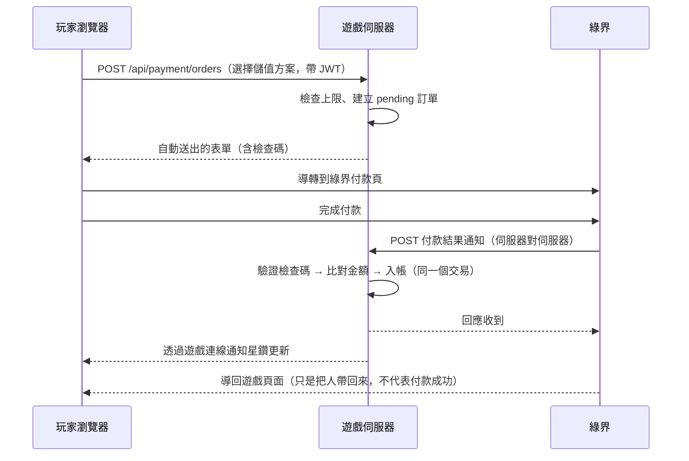

# 付費設計、商城與金流串接規劃

> 狀態：**規劃文件，尚未實作。** 本文件定出付費原則、商城內容、資料表與金流串接流程，作為下一個開發階段的依據。
> 文中的法規說明是整理給開發與營運參考，**不是法律意見**；上線前請由熟悉台灣遊戲與消保法規的律師確認（需確認的項目列在第 7 節）。

## 1. 需要你決定的事

| # | 決定 | 選項 | 建議 | 理由 |
|---|---|---|---|---|
| 1 | 第一家金流 | 綠界 ECPay／藍新 NewebPay／兩者都接 | **先接綠界** | 個人與小公司申請門檻低、文件完整、同時提供電子發票；程式上把金流包成介面，之後加藍新不必改商城 |
| 2 | 是否接 MyCard | 接／不接 | **開服後視需求** | 台灣玩家熟悉、超商買得到點數卡，但抽成明顯較高，且要另外簽約 |
| 3 | 付費貨幣 | 直接用新台幣買商品／**先儲值成「星鑽」再消費** | 星鑽 | 遊戲慣例；金流只處理「儲值」一種交易，商城上下架不必動金流 |
| 4 | 轉蛋（機率型商品） | 開服就有／**開服不做**／永遠不做 | 開服不做 | 需要機率揭露、紀錄保存、對帳抽查等額外義務；先用直購把商城跑順 |
| 5 | 月卡 | 做／不做 | **做**（只給便利性） | 穩定收入，且不賣數值 |
| 6 | 付費道具能否交易 | 可／**不可（帳號綁定）** | 不可 | 可交易等於開放用錢換星幣，直接衝擊遊戲內經濟 |
| 7 | 營業主體 | 公司／行號／個人 | **公司或行號** | 金流特約商店、電子發票、定型化契約都以營業人為前提 |

## 2. 付費原則

GDD 10.1 已定調：「若未來加入付費貨幣，僅限外觀與便利性，不販售數值」。落實成四條紅線：

1. **不賣戰力**：不賣裝備、精煉成功率、精煉保護、素質、技能、傷害或防禦加成。
2. **不賣遊戲內貨幣與可交易道具**：星鑽不能換星幣，付費道具一律帳號綁定、不可交易、不可賣 NPC。
3. **不賣進度**：不賣經驗值、等級直升、任務跳過。經驗加成類只給時間有限、幅度小、且免費玩家也拿得到的版本（見 2.2）。
4. **付費玩家與免費玩家打同一隻怪、掉同樣的東西**：沒有付費限定地圖、付費限定首領。

### 2.1 可以賣的東西

| 類別 | 商品 | 建議價格（星鑽） | 說明 |
|---|---|---|---|
| 外觀 | 時裝（頭、身體、披風的外觀欄） | 150–450 | 另開「外觀欄」蓋過裝備的樣子，不帶任何數值 |
| 外觀 | 武器外觀、髮型、髮色 | 60–300 | |
| 外觀 | 名牌框、聊天氣泡樣式、稱號顏色 | 30–120 | 純顯示 |
| 外觀 | 坐騎外觀 | 300–600 | **不加移動速度**；移動速度是伺服器參數，所有人相同 |
| 外觀 | 公會徽章樣式 | 200 | 由會長購買，全公會顯示 |
| 便利 | 倉庫擴充（+20 格，上限 5 次） | 100／次 | 現有 60 格對一般玩家足夠 |
| 便利 | 角色欄位（第 4、5 個角色） | 200／個 | |
| 便利 | 角色改名卡 | 150 | 要做名稱保留期與改名紀錄，避免用來躲檢舉 |
| 便利 | 外觀重設（重選髮型） | 50 | |
| 便利 | 洗點卷（重置素質） | 100 | GDD 已規劃也能用星幣或旅團徽記取得，付費只是省時間 |
| 月卡 | 旅團通行證（30 天） | 150 | 內容見 2.2 |

### 2.2 月卡內容（全部是便利性）

- 每日登入領 5 顆星鑽（30 天共 150，等於回本；重點是下面幾項）
- 離線擺攤時間 +4 小時（擺攤系統上線後）
- 遠端開啟倉庫（不必走到 NPC）
- 每日任務可多接 1 個（**獎勵與免費任務相同**，只是多一個選擇）
- 月卡專屬名牌框

**刻意不放**：經驗加成、掉落加成、星幣加成。如果營運上一定要有加成，建議改成全伺服器活動（見 `EVENTS.md`），所有人都有。

### 2.3 定價

| 儲值金額（新台幣） | 星鑽 | 備註 |
|---|---|---|
| 30 | 30 | 最低額，接近金流手續費下限，僅供小額試買 |
| 150 | 150 | 月卡價位 |
| 300 | 310 | |
| 990 | 1,050 | |
| 2,990 | 3,250 | 最高額 |

- 1 星鑽 ≈ 新台幣 1 元，換算直覺，客服與退款計算也單純。
- 加贈比例刻意壓低（最高約 8.7%）：加贈太多會逼玩家買大額，對小型遊戲的口碑傷害大於收入。
- 「首次儲值雙倍」可做，但只限一次且寫明條件。
- 贈送的星鑽與付費的星鑽在帳上要分開記（見第 4 節），退款時只退付費的部分。

### 2.4 單筆與每月上限

| 對象 | 單筆上限 | 每月上限 |
|---|---|---|
| 一般帳號 | 2,990 | 30,000 |
| 自行申報未成年的帳號 | 990 | 2,000 |

未成年人儲值是客訴與退款的最大來源。註冊時請玩家申報是否已成年，未成年帳號套用較低上限，並在儲值頁提示「未成年人應經法定代理人同意」。上限數字是建議值，可依營運策略調整。

## 3. 商城功能

### 3.1 玩家端

- 遊戲內「商城」按鈕開啟視窗：分類（外觀、便利、月卡）、商品圖、價格、已擁有標記。
- 外觀類可以先預覽（套在自己角色上看）。
- 購買前跳出確認框，顯示商品名稱、價格、購買後的星鑽餘額，以及「數位內容一經提供即不適用七日鑑賞期」的告知（見 7.2）。
- 「儲值」開新分頁到金流付款頁；付款完成回到遊戲後，星鑽由伺服器通知即時更新，不需重新登入。
- 「購買紀錄」與「儲值紀錄」可在遊戲內查詢。

### 3.2 後台（沿用現有的管理後台）

- 商品上下架、改價、設定販售期間（限時商品）。
- 訂單查詢：依帳號、訂單編號、金流交易編號、日期搜尋；顯示狀態與金流回傳內容。
- 手動補單（金流已收款但遊戲沒入帳）與退款登記，都寫入 `admin_log`。
- 每日營收、付費人數、ARPPU 報表。

### 3.3 商品資料

商品放在資料庫而不是 JSON（要能在後台即時上下架、改價）：

```sql
-- 商城商品
CREATE TABLE shop_products (
  id           TEXT PRIMARY KEY,              -- 例如 costume_starlight
  category     TEXT NOT NULL,                 -- costume / convenience / pass
  name         TEXT NOT NULL,
  description  TEXT NOT NULL,
  price        INTEGER NOT NULL CHECK (price > 0),   -- 星鑽
  -- 購買後給什麼：{"type":"cosmetic","cosmeticId":"..."}、{"type":"storage","slots":20}、{"type":"pass","days":30}
  grant        JSONB NOT NULL,
  -- 每個帳號最多買幾次（NULL 不限）
  limit_per_account INTEGER,
  sale_start   TIMESTAMPTZ,
  sale_end     TIMESTAMPTZ,
  enabled      BOOLEAN NOT NULL DEFAULT true,
  sort_order   INTEGER NOT NULL DEFAULT 0
);

-- 帳號擁有的外觀與權益
CREATE TABLE account_entitlements (
  account_id   INTEGER NOT NULL REFERENCES accounts (id) ON DELETE CASCADE,
  kind         TEXT NOT NULL,                 -- cosmetic / storage_slots / character_slots / pass
  ref          TEXT NOT NULL DEFAULT '',      -- 外觀代號等
  amount       INTEGER NOT NULL DEFAULT 1,
  expires_at   TIMESTAMPTZ,                   -- 月卡到期日
  PRIMARY KEY (account_id, kind, ref)
);
```

## 4. 星鑽帳務

星鑽是「玩家預先付款、尚未消費的金額」，帳務要能逐筆對得上金流的收款。原則與道具系統相同：**每一筆異動都在同一個資料庫交易內寫入餘額與紀錄**。

```sql
-- 星鑽餘額：付費取得與贈送取得分開記
ALTER TABLE accounts
  ADD COLUMN gems_paid  INTEGER NOT NULL DEFAULT 0 CHECK (gems_paid >= 0),
  ADD COLUMN gems_bonus INTEGER NOT NULL DEFAULT 0 CHECK (gems_bonus >= 0);

-- 星鑽異動紀錄（只新增，不修改）
CREATE TABLE gem_ledger (
  id           BIGINT GENERATED ALWAYS AS IDENTITY PRIMARY KEY,
  created_at   TIMESTAMPTZ NOT NULL DEFAULT now(),
  account_id   INTEGER NOT NULL,
  -- topup 儲值、bonus 加贈、purchase 商城消費、refund 退款扣回、admin 人工調整、event 活動贈送
  kind         TEXT NOT NULL,
  paid_delta   INTEGER NOT NULL DEFAULT 0,
  bonus_delta  INTEGER NOT NULL DEFAULT 0,
  order_id     UUID,                          -- 對應 payment_orders
  product_id   TEXT,                          -- 對應 shop_products
  detail       JSONB
);
CREATE INDEX gem_ledger_account_idx ON gem_ledger (account_id, created_at);
```

- **消費順序**：先扣贈送的，再扣付費的。這樣退款時「尚未使用的付費星鑽」最多，對玩家有利，計算也沒有爭議。
- **對帳式**：任何時刻 `SUM(gem_ledger.paid_delta) = accounts.gems_paid`、`SUM(bonus_delta) = gems_bonus`（與道具系統的對帳相同，可寫成每日排程檢查，不符就發警示）。
- **履約保障**：玩家已付款但尚未消費的星鑽餘額，定型化契約規定可能要求提供履約保障（例如信託或銀行保證）。**這一點我沒有查到條文原文，請律師確認適用條件與做法**；帳務上保留「全服未消費付費星鑽總額」的即時查詢，屆時才有數字可以對應。

## 5. 金流串接

### 5.1 台灣常用金流比較

以下是一般性的整理，費率與申請條件會變動，**請以各家官網與業務報價為準**。

| | 綠界 ECPay | 藍新 NewebPay | MyCard | LINE Pay |
|---|---|---|---|---|
| 性質 | 第三方金流 | 第三方金流 | 遊戲點數與代收 | 行動支付 |
| 付款方式 | 信用卡、ATM 虛擬帳號、超商代碼、超商條碼等 | 信用卡、ATM、超商，以及多種行動支付 | 點數卡、會員扣點、電信小額等 | LINE Pay 餘額與綁定的卡 |
| 對遊戲的意義 | 沒有信用卡的玩家可用超商代碼與 ATM | 同左，行動支付選項較多 | 玩家熟悉，超商買得到點數卡 | 手機玩家方便 |
| 手續費 | 依付款方式，信用卡約 2–3%，超商與 ATM 多為每筆定額 | 與綠界相近 | 明顯較高（通常是兩位數百分比） | 約 2–3% |
| 電子發票 | 有自家加值服務 | 有（ezPay） | 由 MyCard 開立或另議 | 無，需另接 |
| 串接方式 | 表單導轉 + 伺服器通知 | 表單導轉（加密）+ 伺服器通知 | 另簽約，API 不同 | 可透過綠界／藍新，或直接串 |

建議路線：**綠界（信用卡 + ATM + 超商代碼）→ 視數據加 LINE Pay（透過綠界或藍新即可）→ 需要時再談 MyCard**。

### 5.2 架構

金流包成介面，商城只認識「訂單」：

```
server/src/payment/
  provider.ts        介面：createCheckout(order) → 導轉用的表單；verifyNotification(body) → 驗證並解析通知
  ecpay.ts           綠界實作
  newebpay.ts        藍新實作（之後）
  orders.ts          訂單狀態機與入帳
  routes.ts          /api/payment/*
```

```sql
CREATE TABLE payment_orders (
  id              UUID PRIMARY KEY DEFAULT gen_random_uuid(),
  -- 送給金流的訂單編號（綠界限 20 碼英數，不可重複）
  merchant_trade_no TEXT NOT NULL UNIQUE,
  account_id      INTEGER NOT NULL REFERENCES accounts (id),
  provider        TEXT NOT NULL,              -- ecpay / newebpay
  amount          INTEGER NOT NULL CHECK (amount > 0),   -- 新台幣
  gems            INTEGER NOT NULL,           -- 付費星鑽
  bonus_gems      INTEGER NOT NULL DEFAULT 0, -- 加贈星鑽
  -- pending 已建立、paid 已付款並入帳、failed 付款失敗、expired 逾期未付、refunded 已退款
  status          TEXT NOT NULL DEFAULT 'pending',
  payment_method  TEXT,                       -- 金流回報的實際付款方式
  provider_trade_no TEXT,                     -- 金流的交易編號
  created_at      TIMESTAMPTZ NOT NULL DEFAULT now(),
  paid_at         TIMESTAMPTZ,
  -- 金流通知的原始內容（除錯與對帳用；不含卡號，金流不會回傳完整卡號）
  raw_notification JSONB,
  invoice_no      TEXT
);
CREATE INDEX payment_orders_account_idx ON payment_orders (account_id, created_at DESC);
```

### 5.3 流程（以綠界全方位金流為例）



依綠界開發者文件（查證時間 2026 年 11 月）：

- 正式環境端點是 `payment.ecpay.com.tw` 下的 `AioCheckOut/V5`，測試環境是 `payment-stage.ecpay.com.tw` 的同一路徑；**必須由前端網頁以表單送出導轉**，不是伺服器直接呼叫。
- 以 `POST`、`application/x-www-form-urlencoded` 送出；`PaymentType` 固定 `aio`；`TotalAmount` 是不含小數的整數；`EncryptType` 固定 `1`（SHA256 檢查碼）。
- `ClientBackURL` 只會把使用者導回頁面、**不帶付款結果**；付款結果以伺服器端的 `ReturnURL` 通知為準。

實作時要對照官方文件確認的細節（我沒有查到這幾段的原文）：檢查碼的參數排序、URL 編碼與雜湊步驟；收到通知後要回應的固定字串；ATM 與超商代碼的「取號結果」通知與「付款完成」通知是分開的兩次。

### 5.4 入帳的安全規則

付款通知是整個系統裡唯一「外部說了算」的地方，必須逐條做到：

1. **只信任伺服器對伺服器的通知**。玩家瀏覽器被導回的那一頁不做任何入帳。
2. **驗證檢查碼**，失敗就拒絕並記安全事件（`payment_bad_signature`，警示等級）。
3. **比對金額**：通知的金額必須等於訂單的金額；不符就拒絕並發警示。
4. **冪等**：同一筆訂單的通知可能重送。入帳用 `UPDATE payment_orders SET status='paid' … WHERE id=$1 AND status='pending'` 並檢查影響列數，只有第一次會入帳（與任務回報防重複領獎的做法相同）。
5. **同一個資料庫交易內**：訂單改為已付款、增加星鑽、寫 `gem_ledger`，三者同生共死。
6. **金鑰只放環境變數**（`ECPAY_MERCHANT_ID`、`ECPAY_HASH_KEY`、`ECPAY_HASH_IV`），不進版本庫、不寫進日誌。
7. **通知端點不需要 JWT**（金流不會帶），所以防護完全靠檢查碼；另外在 Nginx 限制來源 IP 為金流公告的網段更好。
8. **不經手卡號**：付款頁在金流那邊，遊戲伺服器不接觸、不儲存信用卡資料。
9. **逾期訂單**：ATM 與超商代碼有繳費期限，排程把過期的 `pending` 改為 `expired`。
10. **每日對帳**：下載金流的對帳檔，與 `payment_orders` 逐筆比對；金流有、遊戲沒有的要補單，遊戲有、金流沒有的要立刻查。

### 5.5 測試計畫

- 用金流的測試環境與測試卡號跑完整流程：信用卡成功、信用卡失敗、ATM 取號後繳費、超商代碼逾期。
- 自己重送同一份通知三次，確認只入帳一次。
- 竄改通知的金額、竄改檢查碼，確認被拒絕並產生警示。
- 通知送達時玩家不在線上、正在切換地圖、正好登入中，確認星鑽都正確。
- 加進煙霧測試：用本機的假金流端點模擬通知（比照警示 Webhook 的測試方式）。

## 6. 退款與爭議

| 情況 | 處理 |
|---|---|
| 儲值後星鑽完全沒用過，玩家要求退款 | 依服務條款與個案處理；可退時在金流後台退刷，後台登記退款，扣回付費與加贈的星鑽 |
| 已消費部分星鑽 | 原則上只退尚未消費的付費星鑽對應金額；加贈的星鑽全數收回 |
| 未成年人未經同意儲值 | 請法定代理人提供身分與關係證明，查核後退款並收回星鑽與已購買的權益；流程見 `SUPPORT.md` |
| 信用卡爭議款（盜刷、持卡人否認） | 金流通知後，先凍結該帳號的星鑽消費，收回對應星鑽；餘額不足時帳號列為欠款並停權至結清 |
| 付款成功但星鑽沒到 | 客服查 `payment_orders` 與金流後台；金流確實收款就由管理員補單，寫入 `admin_log` |
| 終止服務 | 依定型化契約規定的公告期間與退費方式處理未消費的付費星鑽 |

退款一律走原付款管道，不以遊戲內道具或星幣折抵。

## 7. 法規重點與待律師確認事項

### 7.1 網路連線遊戲服務定型化契約應記載及不得記載事項

- 經濟部於 111 年 8 月 10 日公告修正，112 年 1 月 1 日施行。修正重點是機會型商品（轉蛋等）要揭露機率，並以百分比記載。
- 機率要標示在官網首頁、遊戲登入頁面或購買頁面等處。
- 契約範本要求保存機會型商品的電磁紀錄，保存期限不得少於 180 日，供消費爭議時查驗。
- 不得記載事項包括：不得約定排除消費者的任意解除權、不得約定企業經營者可單方變更契約內容。
- 違反者可依消費者保護法處罰鍰。

對本專案的影響：服務條款要以這份「應記載事項」為骨架（`docs/legal/TERMS.md` 的草稿已盡量對應）；決定不做轉蛋可以省下機率揭露與抽查的負擔；`item_log` 與 `gem_ledger` 的保存期限至少 180 日（建議一年以上）。

### 7.2 七日鑑賞期

- 「通訊交易解除權合理例外情事適用準則」第 2 條第 5 款把「非以有形媒介提供之數位內容或一經提供即為完成之線上服務，經消費者事先同意始提供」列為例外。
- 行政院消保處的函釋指出，是否適用要看實際的商品或服務是否具有「提供後即履行完畢、性質上不易返還」的特性，**需個案判斷，不是所有遊戲點數都當然適用**。
- 排除適用的前提是業者有以清楚易懂的方式告知；把告知夾在一般條款裡，實務上可能被認為不符要件。

對本專案的影響：在**儲值頁與商城購買確認框**都要有醒目的告知並取得同意（勾選或按鈕文字），不能只寫在服務條款裡。星鑽儲值後尚未消費的部分是否適用例外有爭議空間，建議對「完全未使用」的儲值採較寬鬆的退款政策。

### 7.3 其他要處理的項目

| 項目 | 說明 | 狀態 |
|---|---|---|
| 遊戲分級 | 依遊戲軟體分級管理辦法自行分級，在官網、登入頁、商城標示級別與警語 | 待辦；以目前內容判斷大概落在保護級或輔 12 級，請依辦法的標準自評 |
| 個人資料保護法 | 蒐集前告知目的、類別、利用期間與方式、當事人權利 | 草稿見 `docs/legal/PRIVACY.md` |
| 統一發票 | 營業人銷售要開立發票；可用金流的電子發票加值服務，載具或捐贈由玩家選擇 | 待辦 |
| 營業稅與所得稅 | 找會計師確認營業登記項目與稅務處理 | 待辦 |
| 未成年人 | 限制行為能力人的付費行為需法定代理人同意；條款與儲值頁要有提示，並設較低上限 | 設計見 2.4 |
| 履約保障 | 預收的儲值金是否需要信託或銀行保證 | **待律師確認**（我沒有查到條文原文） |
| 主管機關 | 應記載事項由經濟部公告；遊戲產業業務近年有移撥數位發展部的報導 | **待確認現行主管機關與最新版本** |

## 8. 營收與成本的粗估方法

不提供預測數字（沒有任何實際數據可以依據），只列算法，開服後用真實數據代入：

```
月營收 = 月活躍玩家 × 付費率 × 每付費玩家平均消費（ARPPU）
淨收入 = 月營收 ×（1 − 金流手續費率）− 營業稅 − 主機與網路 − 客服與營運人力
```

開服後要追蹤的指標：次日／七日／三十日留存、付費率、ARPPU、首儲轉換時間、各商品銷量、退款率、未成年退款件數。這些在後台報表與每日排程裡產生。

## 9. 實作順序（下一階段）

1. `gem_ledger`、`payment_orders`、`shop_products`、`account_entitlements` 四張表與 migration。
2. 星鑽帳務模組（比照 `db/items.ts` 的交易與紀錄方式）與對帳檢查。
3. 金流介面與綠界實作，先在測試環境跑通；假金流端點加入煙霧測試。
4. 商城後端（購買、權益發放）與外觀欄位（角色的外觀要進同步狀態）。
5. 商城與儲值的用戶端介面、購買與儲值紀錄。
6. 後台：商品管理、訂單查詢、補單、退款登記、營收報表。
7. 電子發票。
8. 法務文件定稿、分級標示、儲值頁的告知文字。
